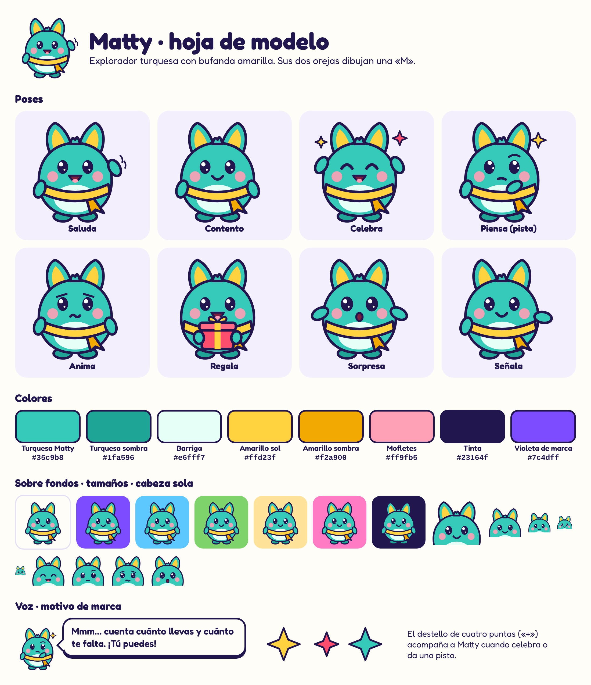

# Matty · guía de personaje

Matty es la mascota y la cara del proyecto: un pequeño explorador turquesa con bufanda amarilla que
acompaña al niño en todo el viaje. Este directorio reúne lo necesario para usarlo fuera de la app
(vídeo, impresos, producto).

## Quién es

- **Qué es**: una criatura redonda y blandita, ni animal conocido ni robot. Sus dos orejas dibujan una **«M»**.
- **Carácter**: curioso, paciente y animoso. Nunca riñe ni se burla; cuando algo sale mal, se preocupa un
  segundo y enseguida propone otra forma de mirarlo.
- **Papel en el juego**
  - **Guía**: saluda, presenta cada actividad y señala qué hacer a continuación en el mapa.
  - **Pistas**: su cara está en la barra de cada juego; al tocarla da un consejo y activa las ayudas en pantalla.
  - **Ánimo**: celebra los aciertos y acompaña los fallos.
  - **Regalos**: trae un regalo cada día y entrega prendas especiales al alcanzar estrellas (la primera, una
    diadema con sus orejas).
- **Cómo habla**: frases cortas, en segunda persona, siempre en positivo. Da la pista, nunca la respuesta.
  «Cuenta cuánto llevas y cuánto te falta.» · «¡Te acompaño!» · «Mañana te traigo otro.»

## Cómo es

| Rasgo | Detalle |
| --- | --- |
| Silueta | Cuerpo en forma de huevo ancho, dos orejas puntiagudas separadas (la «M»), mechón entre ellas |
| Cara | Ojos grandes y ovalados con dos brillos, mofletes rosas, boca pequeña |
| Prenda | Bufanda amarilla con las puntas a su izquierda: es lo que lo identifica como explorador |
| Extremidades | Brazos y pies cortos y redondeados; los brazos hacen toda la expresión corporal |
| Motivo | Destello de cuatro puntas («+») cuando celebra o da una pista |

### Colores

| Uso | Hex |
| --- | --- |
| Turquesa Matty (cuerpo) | `#35c9b8` |
| Turquesa sombra (pies) | `#1fa596` |
| Barriga | `#e6fff7` |
| Amarillo sol (bufanda, interior de orejas) | `#ffd23f` |
| Amarillo sombra (puntas de la bufanda) | `#f2a900` |
| Mofletes | `#ff9fb5` |
| Tinta (contorno, ojos) | `#23164f` |
| Violeta de marca (fondos) | `#7c4dff` |

### Poses

`matty-hi.svg` (saluda) · `matty-happy.svg` (contento) · `matty-cheer.svg` (celebra) ·
`matty-think.svg` (piensa / pista) · `matty-oops.svg` (anima tras un fallo) · `matty-gift.svg` (regala) ·
`matty-wow.svg` (sorpresa) · `matty-point.svg` (señala).

Son vectores independientes, con los colores ya resueltos: se pueden abrir en Illustrator, Figma, Inkscape
o After Effects. Cada parte (orejas, cuerpo, cara, bufanda, brazos) es una forma separada, lo que facilita
animarlo por piezas.

## Normas de uso

- Mantener siempre el contorno de tinta y la bufanda: sin ellos pierde identidad.
- No cambiar el turquesa del cuerpo ni estirar la figura. Para una edición especial, cambiar la bufanda, no el cuerpo.
- Tamaño mínimo de cuerpo entero: 34 px en pantalla. Por debajo, usar solo la cabeza.
- Funciona sobre claros, oscuros y los colores del juego; sobre turquesa o verde azulado, añadir un halo claro.
- Nunca enfadado, triste de verdad ni burlón. Su gesto más serio es el de «anima».

## De dónde sale

El dibujo maestro es código: `src/ui/Matty.tsx`. La hoja de modelo se ve en `/brand.html` con el servidor de
desarrollo (`npm run dev`) y de ahí se exportan estos archivos y el icono de la app (`public/icon.svg`).
Cualquier cambio de forma o color debe hacerse allí y volver a exportarse, para que app y materiales no se separen.

## Antes de fabricar o registrar

- El diseño es original de este proyecto, pero **no se ha hecho ninguna búsqueda de marcas ni de diseños
  registrados**. Antes de invertir en producto conviene encargarla (OEPM / EUIPO).
- El **nombre «Matty»** merece comprobación específica en la clase de juguetes: Mattel ha usado «Matty» como
  nombre de mascota y de tienda. Para una app educativa el riesgo es distinto que para merchandising.
- Es un personaje hecho en vectores sencillos y pensado para pantalla. Para peluche, animación o imprenta a
  gran tamaño lo habitual es que un ilustrador lo pase a limpio (giros de cabeza, tres cuartos, espalda).
